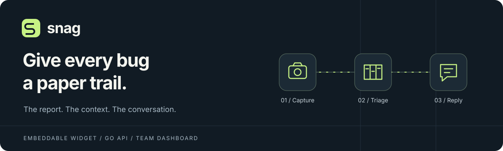
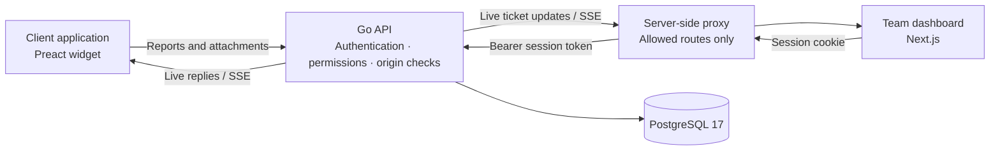
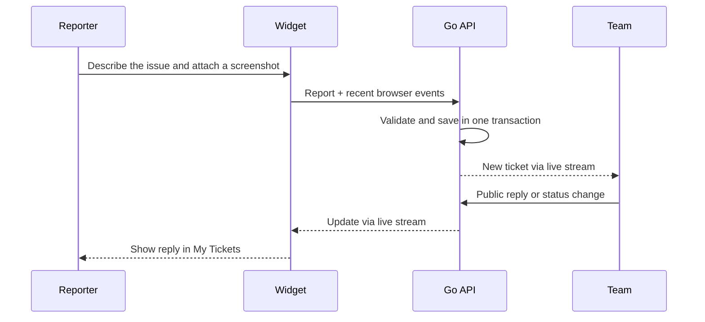

<p align="center">
  
</p>

<p align="center">
  <a href="#run-it-locally">Run locally</a> ·
  <a href="#put-it-in-your-app">Embed the widget</a> ·
  <a href="#how-it-fits-together">Architecture</a> ·
  <a href="docs/implementation.md">Implementation notes</a>
</p>

Snag is a bug-reporting tool for teams supporting several client applications. Embed a widget, collect a report with screenshots and recent browser activity, then handle the conversation in one dashboard.

The reporter stays in your app. Your team gets the context needed to investigate.

## From “it broke” to a useful report

| Capture | Triage | Close the loop |
| :--- | :--- | :--- |
| Open the widget with **Alt+B** or its floating button. Add a screenshot and a description. | Work from an inbox or board. Assign a ticket, set priority, classify coverage, and link duplicates. | Reply to the reporter, keep internal notes private, and broadcast a fix to linked tickets. |
| The last **20 browser events** travel with the report. | Separate projects keep client work organised. Filter by assignee (“Assigned to me”, “Unassigned”). Every change is recorded in the ticket's activity log. | Replies and status changes arrive through live streams, and views catch up automatically after a dropped connection. |

The **AMC report** shows, per project and period, how much work was covered by the maintenance contract (bugs) versus billable new scope (change requests), with open counts and average resolution time. It exports to CSV.

## Website & developer guides

The [website/](website/) directory contains the landing page, getting-started guide, API reference, configuration, testing, deployment, and troubleshooting docs.

```bash
cd website
npm run build
npm test
npm run dev
# Open http://localhost:4173
```

## Run it locally

Install Docker with Compose. The containers provide Go, Node.js, and PostgreSQL.

```bash
git clone https://github.com/Sukhankar/Snag.git
cd Snag
cp .env.example .env
```

Edit `.env`: set `POSTGRES_PASSWORD`, `SNAG_OWNER_EMAIL`, and `SNAG_OWNER_PASSWORD`. Then start the stack:

```bash
docker compose up --build -d
docker compose ps
```

| Address | Purpose |
| :--- | :--- |
| [localhost:3000](http://localhost:3000) | Team dashboard. Sign in with the Owner credentials from `.env`. |
| [localhost:8080/healthz](http://localhost:8080/healthz) | API health check. |
| [localhost:8080/widget.min.js](http://localhost:8080/widget.min.js) | Built widget, served by the Go API. |

The Owner account is created on first start. Changing the bootstrap credentials in `.env` does not reset an existing account; use **My account** in the dashboard.

**Try a report.** With Node.js installed, start the demo host in a separate terminal:

```bash
cd widget
npm ci
npm run demo
```

Open [localhost:5173](http://localhost:5173), press **Alt+B**, and submit a ticket. The example environment includes a demo project that allows this origin.

## Put it in your app

Create a project in the dashboard and add the application's origin. The **Projects** page generates the embed snippet:

```html
<script
  src="https://snag.example.com/widget.min.js"
  data-project-key="pk_..."
  data-app-version="2.4.1"
  async
></script>
```

Use your Snag server URL and the project's key. The widget runs inside a closed Shadow DOM so the host page's CSS stays separate.

| Attribute | Use |
| :--- | :--- |
| `data-api` | Override the API address. |
| `data-user-name`, `data-user-email` | Identify the reporter. |
| `data-fab="false"` | Hide the floating button; keep the keyboard shortcut. |
| `data-mask-text="true"` | Omit clicked text from telemetry. |
| `data-theme`, `data-accent` | Adjust the widget's appearance. |

The JavaScript API exposes `Snag.init({...})`, `open()`, `close()`, `toggle()`, and `identify({name, email})`.

## How it fits together



Only the Go API talks to PostgreSQL. The dashboard proxy forwards the user's session token; the API checks permissions on each request. The realtime broker runs inside the API process.



### One repository, four working areas

| Directory | Responsibility |
| :--- | :--- |
| [`server/`](server/) | Go 1.26 API, chi router, pgx, embedded SQL migrations, widget hosting. |
| [`widget/`](widget/) | Preact + Vite; builds a single embeddable script. |
| [`dashboard/`](dashboard/) | Next.js 16, React, Tailwind, server-side API proxy. |
| [`e2e/`](e2e/) | Playwright browser suites for reports, dashboard workflows, users, and roles. |

## Access and privacy

The **Owner** manages users and roles and always has every permission. Default roles include Admin, Developer, Support Agent, and Viewer; the permission grid lets you adjust them or create your own.

- Role changes apply on the next request. Deactivation and password resets revoke sessions.
- Passwords chosen by an admin (new accounts and resets) are temporary: until the user picks their own, the API allows only reading their profile and changing the password.
- Users cannot grant permissions they do not hold or edit a more privileged user.
- Internal notes stay out of reporter queries and reporter live streams.
- Passwords use Argon2id. Session tokens are stored as SHA-256 hashes on the server; the dashboard uses an HttpOnly session cookie.
- Telemetry keeps a 20-event buffer in memory. It strips URL query strings and does not record input values. Clicked text can be disabled with `data-mask-text`.

For query isolation, attachment validation, origin checks, and storage details, read the [implementation notes](docs/implementation.md).

## Working on Snag

<details>
<summary><strong>Run individual services without Docker</strong></summary>

Use PostgreSQL, Go 1.26.11 or newer, and Node.js compatible with the package manifests. The container build uses Node.js 24. Run these from separate terminals at the repository root.

```bash
# Widget: build once, then serve the demo host
cd widget
npm ci
npm run build
npm run demo
```

```bash
# API: provide DATABASE_URL and Owner credentials in your environment
cd server
export SNAG_WIDGET_FILE="../widget/dist/widget.min.js"
go run ./cmd/snag
```

```bash
# Dashboard
cd dashboard
npm ci
cp .env.example .env.local
npm run dev
```

The API requires `DATABASE_URL`. On first start, provide `SNAG_OWNER_EMAIL` and `SNAG_OWNER_PASSWORD`. See [`server/internal/config/config.go`](server/internal/config/config.go) for the complete configuration.

</details>

<details>
<summary><strong>Test suites</strong></summary>

Start the API, dashboard, and demo host first. Set `ADMIN_TOKEN` to the API's configured `SNAG_ADMIN_TOKEN`; set `OWNER_EMAIL` and `OWNER_PASSWORD` to the test Owner's credentials. Use a development database: these suites create and modify records.

```bash
# From the repository root
server/scripts/smoke.sh
server/scripts/rbac.sh

# Optional rate-limit check: configure the server limit to 5 first
EXPECT_CREATE_LIMIT=5 server/scripts/smoke.sh

cd e2e
npm ci
npm run widget
npm run dashboard
npm run users
```

Browser tests use `playwright-core` and require a locally installed Chrome. Check the suite files for browser paths and environment overrides. Screenshots are local test artifacts and stay out of Git.

</details>

<details>
<summary><strong>Operations and account recovery</strong></summary>

```bash
docker compose logs -f server   # Follow API logs
docker compose up --build -d    # Rebuild after changes
docker compose down            # Stop; retain the database volume
```

To reset an account password:

```bash
read -rs -p 'New password: ' SNAG_NEW_PASSWORD; echo
export SNAG_NEW_PASSWORD
docker compose run --rm -e SNAG_NEW_PASSWORD server set-password owner@example.com
unset SNAG_NEW_PASSWORD
```

Replace the email with the account to reset. `docker compose down -v` deletes the database volume; use it only when you intend to discard that data.

</details>

## Current boundaries

- **One realtime API replica.** Multiple replicas need a shared event transport behind the broker.
- **Email and password sign-in.** SSO, OIDC, and two-factor authentication are not implemented.
- **Browser origins only.** Electron and `file://` hosts with a null origin are not supported yet.
- **Attachments live in PostgreSQL.** Payloads are base64 text; object storage is not part of this implementation.

The origin allowlist protects browser integrations; it is not authentication against clients that can forge headers. Project and IP rate limits are a separate control.

## License

Snag is licensed under the [Apache License 2.0](LICENSE).
Copyright 2026 Sukhankar. Third-party dependencies retain their own licenses.
